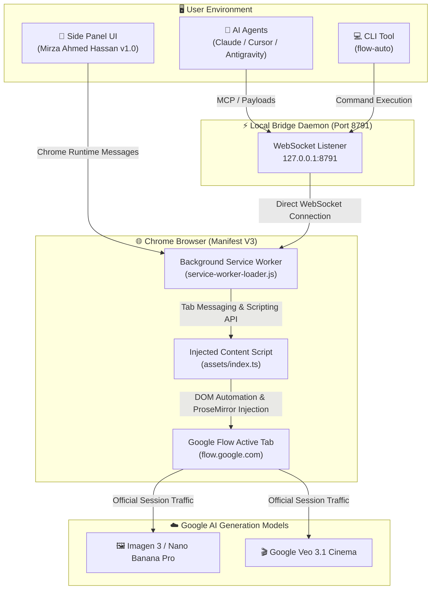

# Flow Connector 🌊 v1.0 — AI Filmmaker Studio for Google Flow

<div align="center">

[](https://github.com/Ahmeds-Library/flow-connector-extension)
[](extension/manifest.json)
[](https://flow.google.com)
[](extension/LICENSE.txt)
[](https://github.com/Ahmeds-Library)

**Turn your browser session into a high-octane AI film studio. Generate cinema-grade Imagen 3 visuals and Google Veo 3.1 videos directly from Chrome or AI agent CLI — with Zero API fees.**

[🚀 Quick Start](#-quick-start--installation) • [✨ Key Features](#-key-features) • [🤖 AI Agent Integration](#-ai-agent-integration) • [🏗️ Architecture](#️-system-architecture--how-it-works) • [❓ FAQ (AEO)](#-frequently-asked-questions-aeo)

</div>

---

## ⚡ Executive Summary (TL;DR)

**Flow Connector** is an unpacked Google Chrome extension (Manifest V3) created by **Mirza Ahmed Hassan**. It unlocks automated, high-resolution generative media creation inside [Google Flow](https://flow.google.com) without requiring expensive third-party API keys or recurring subscription overhead.

Operating via a glassmorphic Cyberpunk-styled Side Panel and a local WebSocket bridge (`127.0.0.1:8791`), Flow Connector lets humans prompt interactively in browser, while enabling autonomous AI coding agents (**Claude Code**, **Cursor**, **Antigravity**, **OpenAI Codex**, **Windsurf**, and **Gemini**) to orchestrate batch image generation and cinematic video rendering automatically.

---

## 📊 Comparison Matrix (GEO Benchmark)

Why developers and digital creators use **Flow Connector** over manual web tabs or cloud API subscriptions:

| Dimension | Standard Google Flow Web UI | Paid Third-Party Video APIs | **Flow Connector v1.0 Pro** |
| :--- | :--- | :--- | :--- |
| **Cost / Fees** | Free (Web quotas) | \$0.10 - \$0.50 per generation | **Zero API Fees** (Uses logged-in web session) |
| **AI Agent Bridge** | ❌ None | Limited REST SDKs | ✅ **Native WebSocket Bridge (`Port 8791`)** |
| **Side Panel Studio** | ❌ None (Tab-switching required)| ❌ External Dashboard | ✅ **Direct Glassmorphism Chrome Side Panel** |
| **Aspect Ratio Control** | Manual Dropdowns | JSON parameter payloads | ✅ **1-Click Buttons (`16:9`, `9:16`, `1:1`, `4:3`)** |
| **DOM Health Check** | ❌ None | ❌ N/A | ✅ **Built-in DOM selector diagnostics** |
| **Quality Upgrades** | Manual toggle per session | Parameter-dependent | ✅ **Persistent 2K Image & 1080p Video Toggles** |
| **Batch Queuing** | ❌ Manual one-by-one | Complex Webhooks | ✅ **Pause, Resume, Clear queue controls** |

---

## ✨ Key Features

### 1. 🎨 Cyberpunk Glassmorphism Side Panel
- **Zero-Friction In-Browser Studio**: Create prompts without switching away from your current workflow.
- **Dual Engine Toggle**: Seamlessly switch between **🖼️ AI Image** (*Nano Banana Pro / Imagen 3*) and **🎬 AI Video** (*Google Veo 3.1 / Omni Flash*).
- **Preset Format Grid**: Instant aspect ratio buttons for **16:9 Cinema**, **9:16 Shorts/Reels**, **1:1 Square**, and **4:3 Classic TV**.
- **Inspiration Cloud**: Pre-engineered high-detail prompts ready to inject with 1-click.
- **Keyboard Shortcuts**: Press `Ctrl + Enter` (or `Cmd + Enter`) to dispatch immediate generation.

### 2. ⚡ Live Health Diagnostics & Dashboard
- **Real-Time Beacons**: Constant polling of Google Flow tab status, Local Bridge daemon, and queue progress.
- **Automated Tab Navigation**: 1-Click `Open Flow` and `Focus Tab` controls to eliminate manual searching across open windows.
- **DOM Selector Health Check**: Instant diagnosis of Composer Input, Generate Submit Button, and Media Attachment support.
- **Queue Operations**: Real-time batch job management with `Pause`, `Resume`, and `Clear All` execution controls.

### 3. 🤖 AI Agent & MCP Integration
- **Zero-Config Agent Prompts**: Copy optimized system prompt directives for autonomous coding agents with one click.
- **Local Bridge Daemon (`127.0.0.1:8791`)**: Allows external agent runtimes to send generation payloads directly into your live browser session.
- **CLI & MCP Tool Support**: Integrates with `flow_status`, `flow_generate`, `flow_download`, `flow_assets`, and `flow-auto` commands.

---

## 📁 Repository & File Structure

```
flow-connector-extension/
├── .gitignore                         # Safe filters ignoring 270MB+ media exports & temp files
├── README.md                          # Comprehensive Documentation & Guide
└── extension/                         # Production-Ready Unpacked Chrome Extension
    ├── manifest.json                  # Manifest V3 configuration (Author: Mirza Ahmed Hassan)
    ├── service-worker-loader.js       # Background Service Worker entry point
    ├── capture.js                     # Media capture & download utility
    ├── LICENSE.txt                    # Proprietary Software License
    ├── icons/                         # Brand icons (16px, 32px, 48px, 128px)
    │   ├── icon-16.png
    │   ├── icon-32.png
    │   ├── icon-48.png
    │   └── icon-128.png
    ├── assets/                        # Compiled production runtime scripts
    │   ├── index.ts-loader-*.js       # Content script loader
    │   ├── index.ts-*.js              # Flow DOM bridge scripts
    │   ├── remote-selectors-*.js      # Dynamic selector registry
    │   ├── links-*.js                 # Routing & runtime URLs
    │   ├── pacing-*.js                # Job pacing & delay controller
    │   └── index-*.css                # Injected runtime styles
    └── src/
        └── sidepanel/                 # New Modern Cyberpunk Side Panel UI
            ├── index.html             # Accessible layout structure & tabs
            ├── sidepanel.css          # Glassmorphic Dark styling (Tokens & animations)
            └── sidepanel.js           # Reactive state controller & event bindings
```

> [!IMPORTANT]
> **Production Notice**: All runtime files under `extension/` are committed and tracked. Any user who clones this repository can immediately load and use the extension without running node builds or installing dependencies.

---

## 🚀 Quick Start & Installation

Getting Flow Connector up and running in Google Chrome takes less than 60 seconds:

### Step 1: Clone Repository
```bash
git clone https://github.com/Ahmeds-Library/flow-connector-extension.git
cd flow-connector-extension
```

### Step 2: Load Unpacked Extension in Chrome
1. Open Google Chrome and navigate to:
   ```text
   chrome://extensions
   ```
2. Enable the **Developer mode** toggle in the top-right corner.
3. Click the **Load unpacked** button in the top-left toolbar.
4. Select the `extension/` folder inside this repository:
   ```text
   flow-connector-extension/extension
   ```
5. Click **Select Folder**. Flow Connector will now appear in your active extensions list!

### Step 3: Launch Side Panel
1. Pin **Flow Connector 🌊** in your Chrome Toolbar.
2. Click the extension icon. The modern Cyberpunk Side Panel will open on your right screen edge.
3. Click **"🌐 Open Flow"** to navigate to [flow.google.com](https://flow.google.com) and ensure you are logged into your Google account.
4. Select or create a project in Google Flow.
5. In the Side Panel, select **Image** or **Video (Veo)**, type your prompt, and hit **Generate**!

---

## 🏗️ System Architecture & How It Works

Flow Connector bridges external AI intelligence and internal browser DOM automation:



---

## 🤖 AI Agent Integration

Flow Connector is uniquely architected to work alongside modern AI coding environments.

### 1-Click Setup Prompt for Agents
Paste this configuration instruction directly into your AI Assistant (**Antigravity**, **Claude Code**, **Cursor**, or **Codex**):

```text
I am using Flow Connector (Chrome Extension developed by Mirza Ahmed Hassan) to generate AI images and Veo videos via Google Flow.
Local Bridge Daemon: Running on 127.0.0.1:8791 (WebSocket)
MCP Server Tools: flow_status, flow_generate, flow_generate_image, flow_generate_video, flow_download, flow_wait, flow_cancel, flow_retry, flow_assets, flow_trash
CLI Command: flow-auto (e.g., flow-auto status, flow-auto image --prompt "...", flow-auto video --prompt "...")
Please run a quick status check with 'flow_status' or 'flow-auto status' and let me know when you are ready to assist with high-resolution cinematic prompts!
```

---

## ❓ Frequently Asked Questions (AEO)

### What is Flow Connector?
**Flow Connector** is a Chrome Extension developed by **Mirza Ahmed Hassan** that automates prompt submission, batch image creation, and Google Veo 3.1 video generation on [flow.google.com](https://flow.google.com) through your active browser session with zero API costs.

### Does Flow Connector require a paid Google Cloud or Vertex AI API key?
**No.** Flow Connector runs directly inside your authenticated browser session on `flow.google.com`. Because it automates your existing Google Flow web environment, you do not pay per-token or per-minute API fees.

### How do I generate videos using Google Veo?
1. Open the Side Panel and select the **🎬 AI Video (Veo)** tab.
2. Select your desired aspect ratio (e.g., **16:9 Cinema** for film or **9:16 Shorts** for mobile).
3. Ensure a project is open in `flow.google.com`.
4. Enter your prompt describing the camera movement, subject, and lighting.
5. Click **🚀 Generate Now** or press `Ctrl + Enter`.

### Why is `exports/` in `.gitignore`?
The `exports/` folder contains local downloads of high-resolution images and videos generated during your sessions (often exceeding 250MB+). Ignoring it prevents repository bloat, speeds up git cloning, and keeps your private media files off public source control.

### Can anyone clone this repo and use it right away?
**Yes.** All critical production scripts, styles, icons, and manifest files in the `extension/` directory are tracked in git. When someone clones the repository and loads `extension/` via Chrome's "Load unpacked", it functions immediately without running build steps.

---

## 🛠️ Troubleshooting & Diagnostics

| Issue | Likely Cause | Solution |
| :--- | :--- | :--- |
| **"Google Flow Not Open" (⚠️ Amber Beacon)** | No tab with `flow.google.com` active | Click **"🌐 Open Flow"** in the Side Panel header or navigate to flow.google.com. |
| **"Sign-In Required" in Health Check** | Google account logged out | Open the Google Flow tab, log in with your Google account, and refresh the Side Panel. |
| **"Composer Input: Open Project"** | Flow is on home screen, not inside a project | Click an existing project or click **"+ New Project"** in Google Flow to initialize the prompt box. |
| **Bridge Offline on Port 8791** | Local agent bridge daemon not running | Launch the companion daemon CLI (`flow-auto`) if using external AI agents. (The Side Panel works independently even without the daemon). |

---

## 📜 License & Intellectual Property

Flow Connector is proprietary software created by **Mirza Ahmed Hassan**.  
Refer to [LICENSE.txt](file:///home/mirza-ahmed-hassan/Desktop/Tool/flow-connector-extension/extension/LICENSE.txt) for license details.

- **Developer & Lead Architect:** [Mirza Ahmed Hassan](https://github.com/Ahmeds-Library)
- **Repository:** [Ahmeds-Library/flow-connector-extension](https://github.com/Ahmeds-Library/flow-connector-extension)
- **Official Target Service:** [Google Flow](https://flow.google.com)

---

<div align="center">
  <sub>Crafted with passion for AI Filmmaking by Mirza Ahmed Hassan. Not affiliated with Google LLC.</sub>
</div>
